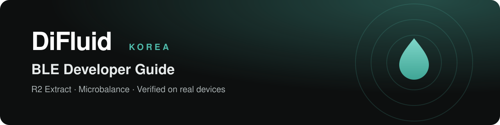

<p align="center"></p>

<p align="center"><a href="README.md">한국어</a> · <b>English</b></p>

<p align="center">
  <a href="LICENSE-DOCS.md"></a>
  <a href="LICENSE"></a>
  <a href="https://www.difluid.kr"></a>
  <a href="https://180coffee.com"></a>
</p>

# DiFluid BLE Developer Guide

How to connect DiFluid devices to your own app or hardware over Bluetooth LE — **checked on real devices**. Byte-level examples, measured timings, where the vendor docs differ, and a Python example you can run today.

> [!NOTE]
> Maintained by **Vidastech**, the official DiFluid distributor in Korea. DiFluid's own [difluid-sdk-demo](https://github.com/DiFluid/difluid-sdk-demo) is the authoritative protocol; this guide checks and supplements it on real devices. DiFluid's documents are listed under [DiFluid's official material](#difluids-official-material).

## Devices

| Device | Measures | Guide | Example | Product |
|---|---|---|---|---|
| **R2 Extract** | Refractometer — coffee TDS and refractive index | [Get started](r2/README.en.md) · [Protocol](r2/protocol.md) | [r2_minimal.py](examples/python/r2_minimal.py) | [difluid.kr](https://www.difluid.kr/R2Extract) |
| **Microbalance · Ti** | Scale — weight, flow, timer | [Get started](microbalance/README.en.md) · [Protocol](microbalance/protocol.md) | [microbalance_minimal.py](examples/python/microbalance_minimal.py) | [difluid.kr](https://www.difluid.kr/Microbalance) |
| **Omix Plus** | Bean analyzer — receive roast color, moisture, density (receive only, contributed material) | [Get started](omixplus/README.en.md) · [Protocol](omixplus/protocol.md) | [omixplus_minimal.py](examples/python/omixplus_minimal.py) | [difluid.kr](https://www.difluid.kr/OmixPlus) |

All three use DiFluid's frame format (`DF DF func cmd len data sum`), but commands and responses differ per device, and so does the byte order (the R2 and scales are big-endian, the Omix Plus is little-endian).

## Three commands to a first reading

```bash
pip install bleak                                   # Python 3.9+
python examples/python/r2_minimal.py scan           # find nearby R2 units
python examples/python/r2_minimal.py listen --address <ADDRESS> --single
```

> [!TIP]
> The R2 does not advertise while it is connected. Disconnect it from the phone app (DiFluid Café) first.

## What makes this guide different

- **A status on every fact** — ✅ measured · 📄 vendor document only · ❓ unknown. Nothing unverified is stated as fact.
- **Raw captures (R2, Omix Plus)** — the byte logs behind each conclusion, with only unit identifiers redacted. We kept no raw logs for the scales (Microbalance, Ti); only the measured frames pinned in our tests are published. The Omix Plus captures and device checks are the contributor's.
- **Where the docs differ** — typos and mismatches in the vendor docs, corrected against real bytes or the frame rules (items checked on a device are marked ✅).
- **Product experience** — pitfalls we hit integrating into a real product, and the rules we adopted.

## DiFluid's official material

What DiFluid has published on GitHub ([DiFluid](https://github.com/DiFluid)). This guide was checked against [difluid-sdk-demo commit `df4e073`](https://github.com/DiFluid/difluid-sdk-demo/tree/df4e0731dc646b9110479cb3b39bb69346e0a640) (2024-12-24, still the latest on 2026-11-02). "Checked" links are pinned to that commit; "Latest" links change when DiFluid edits its documents.

| DiFluid document | Covers | Checked | Latest | In this guide |
|---|---|---|---|---|
| difluid-protocol.md | Common frame format | [v1.0.0 · 2023-03-18](https://github.com/DiFluid/difluid-sdk-demo/blob/df4e0731dc646b9110479cb3b39bb69346e0a640/docs/difluid-protocol.md) | [view](https://github.com/DiFluid/difluid-sdk-demo/blob/master/docs/difluid-protocol.md) | Frame: [R2](r2/protocol.md#2-프레임--frame) · [Scales](microbalance/protocol.md#2-프레임--frame) · [Omix Plus](omixplus/protocol.md#2-프레임--frame) |
| protocolR2.md | R2 Extract | [v1.0.0 · 2023-03-18](https://github.com/DiFluid/difluid-sdk-demo/blob/df4e0731dc646b9110479cb3b39bb69346e0a640/docs/protocolR2.md) | [view](https://github.com/DiFluid/difluid-sdk-demo/blob/master/docs/protocolR2.md) | [Differences](r2/protocol.md#6-벤더-문서와-다른-점--differences-from-the-vendor-document) |
| protocolMicrobalance.md | Microbalance · Ti | [v1.0.0 · 2024-12-24](https://github.com/DiFluid/difluid-sdk-demo/blob/df4e0731dc646b9110479cb3b39bb69346e0a640/docs/protocolMicrobalance.md) | [view](https://github.com/DiFluid/difluid-sdk-demo/blob/master/docs/protocolMicrobalance.md) | [Differences](microbalance/protocol.md#9-벤더-문서와-다른-점--differences-from-the-vendor-document) |
| protocolOmni.md | Omni — a different device from the Omix Plus | [v1.0.0 · 2024-12-24](https://github.com/DiFluid/difluid-sdk-demo/blob/df4e0731dc646b9110479cb3b39bb69346e0a640/docs/protocolOmni.md) | [view](https://github.com/DiFluid/difluid-sdk-demo/blob/master/docs/protocolOmni.md) | [Compared with the Omix Plus](omixplus/protocol.md#6-벤더-문서와-비교--compared-with-the-vendor-documents) |
| README | Connection steps, running the demo app (uniapp) | [2024-12-24](https://github.com/DiFluid/difluid-sdk-demo/blob/df4e0731dc646b9110479cb3b39bb69346e0a640/README.md) | [view](https://github.com/DiFluid/difluid-sdk-demo/blob/master/README.md) | — |

Also: [General Coffee Concept](https://github.com/DiFluid/General-Coffee-Concept) — DiFluid's articles on coffee concepts. It has a Brew Control Chart article; the TDS and extraction yield pages are empty (checked 2026-11-02).

## Update history

| Date | Change |
|---|---|
| 2026-11-02 | Added [DiFluid's official material](#difluids-official-material) to the front page — links pinned to the DiFluid commit we checked against (`df4e073`), plus latest |
| 2026-11-02 | Added the **Omix Plus** receive guide and example ([omixplus/](omixplus/README.en.md)). Source contributed by roaster 이승진 of [180 Coffee Roasters](https://180coffee.com) |
| 2026-11-02 | First release — **R2 Extract** and **Microbalance · Ti** guides with Python examples (Korean / English) |

## Feedback

If you built something with this guide, tell us. Each link opens an email with the subject and a short form filled in.

| What | Email | Please include |
|---|---|---|
| Share a use case | [Email [Use case]](mailto:difluid.kr@gmail.com?subject=%5BUse%20case%5D%20&body=What%20you%20built%3A%0ADevice%20and%20firmware%3A%0AMay%20we%20feature%20it%20in%20the%20guide%20%28yes/no%29%3A%0ALink%3A%0A) | What you built, device and firmware, whether we may feature it |
| Report an error or bug | [Email [Bug]](mailto:difluid.kr@gmail.com?subject=%5BBug%5D%20&body=Page%20or%20code%20%28link%29%3A%0ADevice%20model%20and%20firmware%3A%0AWhat%20happened%3A%0AWhat%20you%20expected%3A%0ARaw%20byte%20log%20%28attach%20if%20any%29%3A%0A) | Page or code, device model and firmware, what happened, raw byte log |
| Request a feature | [Email [Feature request]](mailto:difluid.kr@gmail.com?subject=%5BFeature%20request%5D%20&body=Feature%20or%20device%20you%20need%3A%0AYour%20use%20case%3A%0A) | The feature or device, your use case |
| Contribute material | [difluid.kr@gmail.com](mailto:difluid.kr@gmail.com) | Protocol notes, captures, code — published with your name after review |

[GitHub issues](https://github.com/difluid-korea/difluid-ble-guide/issues) work too. Use cases are featured only with your consent.

## Contributors

- Omix Plus source: roaster 이승진 — [180 Coffee Roasters](https://180coffee.com)

## License

- Documentation and capture logs: [CC BY 4.0](LICENSE-DOCS.md) — free to use with attribution.
- Example code: [MIT](LICENSE)

DiFluid's protocol documents are DiFluid's own work (MIT, © Shenzhen Digitizing Fluid Technology Co., Ltd.). This repository links to them rather than copying them, and restates only facts such as byte values. DiFluid, R2 Extract, Microbalance, Omix and DiFluid Café are trademarks of their respective owner.

---

<p align="center"><b>DiFluid Korea</b> · <a href="https://www.difluid.kr">difluid.kr</a> · <a href="mailto:difluid.kr@gmail.com">difluid.kr@gmail.com</a></p>
